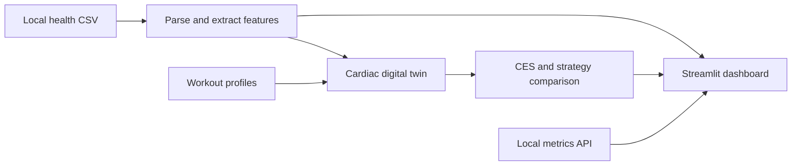

<div align="center">

# 🫀 Cardio Digital Twin

### Explore cardiovascular training through data and simulation.

A dashboard for wearable health trends, workout comparison, recovery insights, and an interactive cardiac digital twin.


[Quick start](#quick-start) · [Dashboard](#dashboard) · [Health data](#health-data) · [Documentation](#documentation)

</div>

## Overview

Cardio Digital Twin brings health metrics and workout simulations into one interface. Explore heart-rate and HRV trends, compare training strategies, and see how a simplified cardiovascular model responds to activity and recovery.

Start with built-in demo values, try the included synthetic dataset, or load your own local health export. A companion Flask API accepts incoming metrics, while a separate 3D view visualizes a beating heart.

> **For research and educational exploration.** Scores, forecasts, and risk indicators are experimental and are not clinically validated. Do not use them for diagnosis, cardiac-event prediction, or treatment decisions.

## Highlights

| Capability | What you can explore |
| --- | --- |
| **Health dashboard** | Resting heart rate, HRV, training zones, and recovery trends |
| **Cardiac digital twin** | Simulated heart rate, fatigue, recovery, and HRV responses |
| **Workout comparison** | Five training strategies ranked using CES and a fatigue penalty |
| **Coaching tools** | Workout suggestions, weekly plans, and live-coaching demonstrations |
| **Forecasts and simulation** | Illustrative training and recovery scenarios |
| **3D heart view** | An animated anatomical model alongside simulated metrics |

The project combines physiological simulation and rule-based scoring. It does not include a trained machine-learning model or native Apple HealthKit integration.

## Dashboard

The main application, **`app_final.py`**, organizes the experience into seven tabs:

| Tab | Focus |
| --- | --- |
| 📊 Dashboard | Health metrics, training zones, and recovery readiness |
| 📱 Live Coach | Live-metrics integration and coaching demonstrations |
| 🤖 Today's Coach | Daily workout suggestions and weekly planning |
| 🫀 Cardiac Analysis | Cardiovascular metrics and simulated responses |
| 🤖 Training Intelligence | Workout strategies and training analysis |
| 💪 Recovery & Sleep | Recovery and sleep-related insights |
| 📈 Forecast & Simulator | Projections and training scenarios |

Some panels use illustrative values or assumptions. See [scope and limitations](#scope-and-limitations) before interpreting the outputs.

## How it works



The simulation advances in one-minute steps. The strategy optimizer compares **HIIT, Steady Cardio, Recovery Day, Tempo Run, and Strength Circuit** using a composite Cardiac Enhancement Score (CES), adjusted for fatigue. Model details are in the [architecture reference](docs/architecture.md).

## Quick start

**Requirements:** Python 3.12 or newer and `pip`. Run the following commands from a terminal.

### 1. Clone and create an environment

```bash
git clone https://github.com/Srinivas984/Cardio-Fitness-Digital-Twin.git
cd Cardio-Fitness-Digital-Twin
python -m venv .venv
```

### 2. Activate the environment

**Windows PowerShell**

```powershell
.\.venv\Scripts\Activate.ps1
```

**macOS / Linux**

```bash
source .venv/bin/activate
```

### 3. Install and launch

```bash
python -m pip install -r requirements.txt
python -m streamlit run app_final.py
```

Open **[http://localhost:8508](http://localhost:8508)**. The main dashboard runs without personal health data or the API; its live-metrics features use the companion service below.

## Run the full application

### Windows launcher

After creating `.venv` and installing dependencies, start the API and both primary dashboards together:

```powershell
powershell -ExecutionPolicy Bypass -File .\RUN_ALL.ps1
```

To stop services started by this launcher:

```powershell
powershell -ExecutionPolicy Bypass -File .\STOP_ALL.ps1
```

The launcher runs services in the background, saves logs in `.runtime/`, and skips occupied ports. The stop script only targets processes recorded by the launcher.

### Start services individually

Use separate terminals with the environment activated, running commands from the repository root.

| Service | Command | Address |
| --- | --- | --- |
| Coaching dashboard | `python -m streamlit run app_final.py` | [localhost:8508](http://localhost:8508) |
| Metrics API | `python healthkit_api_server.py` | [localhost:5000/health](http://localhost:5000/health) |
| Experimental risk dashboard | `python -m streamlit run app_risk_alert.py --server.port=8509` | [localhost:8509](http://localhost:8509) |
| Alternative 3D dashboard | `python -m streamlit run app.py --server.port=8510` | [localhost:8510](http://localhost:8510) |

The 3D renderer loads Three.js from public CDNs and requires internet access. The main dashboard also requests Google Fonts. Attribution for the included heart model is in [third-party notices](THIRD_PARTY_NOTICES.md).

## Health data

### Demo mode

No export is needed to start. When no supported CSV is found, the main dashboard uses demo defaults.

For a richer example with **14 days of synthetic data**, copy `examples/HealthAutoExport-demo.csv` into `data/`:

**Windows PowerShell**

```powershell
New-Item -ItemType Directory -Path data -Force | Out-Null
Copy-Item examples/HealthAutoExport-demo.csv data/
```

**macOS / Linux**

```bash
mkdir -p data
cp examples/HealthAutoExport-demo.csv data/
```

Restart the dashboard to load the example.

### Your own export

1. Place a supported daily Health Auto Export CSV in `data/`.
2. Name it `HealthAutoExport-<anything>.csv`.
3. Keep only the intended CSV matching that pattern; remove the synthetic copy first.
4. Restart the dashboard to refresh its cached data.

The alternative `app.py` dashboard optionally reads Apple Health XML from `data/export.xml`. The main coaching dashboard uses the CSV format described above.

**Privacy:** files under `data/` are ignored by Git, except the empty directory placeholder. Keep real exports out of public issues, screenshots, and pull requests. See the [CSV schema and API reference](docs/data.md) for supported fields and upload examples.

## Project structure

```text
Cardio-Fitness-Digital-Twin/
├── app_final.py             # Main coaching dashboard
├── app_risk_alert.py        # Experimental risk dashboard
├── app.py                   # Alternative 3D-heart dashboard
├── healthkit_api_server.py  # Local Flask API
├── healthkit_connector.py   # Demo connector and streaming helpers
├── live_coach.py            # Coaching logic
├── adaptive_workouts.py     # Workout adaptation helpers
├── heart_animation.py       # 3D heart renderer
├── heart.glb                # Heart model with separate attribution
├── backend/                 # Parsers, models, and analysis
├── simulation/              # Workout and recovery simulations
├── scoring/                 # Composite CES scoring
├── data/                    # Local exports; contents ignored by Git
├── examples/                # Synthetic sample data
├── tests/                   # Automated checks
├── docs/                    # Architecture and data reference
├── .github/workflows/       # Continuous integration
└── requirements.txt         # Python dependencies
```

Root-level modules including `digital_twin.py`, `simulator.py`, and `ces_score.py` support the alternative 3D dashboard. The coaching dashboard uses the implementations in `backend/`, `simulation/`, and `scoring/`.

## Development and testing

Run the checks from the repository root:

```bash
python -m unittest discover -s tests -v
```

The suite covers synthetic CSV parsing, simulation and optimizer integration, API validation, upload/retrieval, and initial rendering of all three dashboards. It uses no private exports and requires no running API. GitHub Actions is configured to run the checks on Python **3.12** and **3.14**.

These are application checks, not validation of physiological accuracy. Manually verify dashboard interactions when changing the interface. Contribution guidance is in [CONTRIBUTING.md](CONTRIBUTING.md).

## Documentation

| Reference | Contents |
| --- | --- |
| [Architecture](docs/architecture.md) | Application pipelines, simulation, and scoring |
| [Data and API](docs/data.md) | CSV columns, endpoints, and request examples |
| [Contributing](CONTRIBUTING.md) | Development workflow and pull requests |
| [Security](SECURITY.md) | Local-use boundaries and sensitive data |
| [Third-party notices](THIRD_PARTY_NOTICES.md) | Heart-model attribution and external resources |

## Scope and limitations

- **Experimental outputs:** recovery, fatigue, CES, and risk indicators are exploratory scores. Several UI deltas, zone distributions, and forecasts contain illustrative constants or assumptions.
- **Demo integration:** the connector generates sample readings. Incoming metrics can be submitted through the API, but direct Apple Watch authentication, native HealthKit access, and automatic iCloud synchronization are not implemented.
- **Estimated HRV:** the API derives HRV using a heuristic with random variation; it is not measured SDNN.
- **Temporary storage:** uploaded metrics live in memory, are cleared on restart, and fall back to demo values after five minutes.
- **Local operation:** services bind to loopback by default. The API has no authentication and is intended for local development. Review [SECURITY.md](SECURITY.md) before changing network exposure.

## License

A license for the project code has not yet been selected. Third-party components retain their own licenses; the heart model is provided under **CC BY 4.0**, as recorded in [THIRD_PARTY_NOTICES.md](THIRD_PARTY_NOTICES.md).
