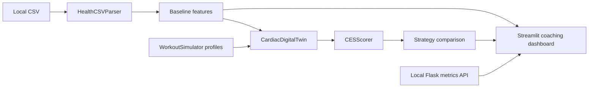

# Architecture

## Main dashboard

`app_final.py` loads a local Health Auto Export CSV through `backend/health_data_csv_parser.py`. It computes baseline features and renders seven tabs. Without a matching CSV, it uses demo defaults. Cached data is refreshed when the process restarts.

`backend/cardiac_model.py` models heart rate, fatigue, recovery, and HRV at one-minute intervals. `simulation/workout_simulator.py` generates five profiles: HIIT, Steady Cardio, Recovery Day, Tempo Run, and Strength Circuit. `backend/optimizer_ai.py` simulates each and ranks scores with a fatigue penalty. This is a strategy search, not a trained model.

`scoring/ces_score.py` computes a bounded 0-100 composite: resting heart rate (20%), recovery rate (25%), HRV (25%), fatigue (15%), and training efficiency (15%). These weights and bands are project assumptions, not clinical standards.

`simulation/cardiac_simulator.py` provides longer training-block simulations. Other backend modules contain prediction, explanation, sleep, and recovery helpers. Some are experimental and are not exposed by every dashboard tab.

## Live metrics

`healthkit_api_server.py` provides demo readings and accepts incoming metrics. It retains the most recent upload in memory and uses it for five minutes. `healthkit_connector.py` is a demonstration connector; it does not implement native HealthKit access.

`app_risk_alert.py` calls the API and presents heuristic risk outputs. These are not calibrated probabilities of a cardiac event. `live_coach.py` and `adaptive_workouts.py` implement coaching and workout helpers.

## Alternative 3D dashboard

`app.py` uses root-level `simulator.py`, `digital_twin.py`, `optimizer.py`, `prediction.py`, `risk_detection.py`, and `ces_score.py`. This is a separate, simpler pipeline. It optionally reads `data/export.xml` through `backend/data_loader.py` and falls back to defaults. `heart_animation.py` renders `heart.glb` through Three.js loaded from CDNs.

## Verification

`tests/test_project.py` checks synthetic parsing, finite simulation outputs, optimizer integration, API input validation and upload/retrieval, and initial Streamlit rendering. Dashboard tests use a temporary directory without personal exports. These checks do not establish physiological validity or cover every interaction.
